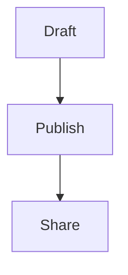
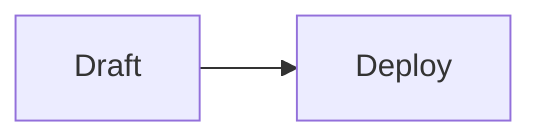

# LLM API Documentation (wiki.david888.com)

This document explains how AI agents (like OpenClaw, n8n, ChatGPT) or external scripts can programmatically interact directly with the CF-Notepad (david888 wiki) server.

## Overview
The wiki supports **reading**, **writing**, **appending**, **optional note-history access**, and **image uploading** via simple HTTP requests.

The underlying page storage can hold very large markdown pages, but that is **not** a guarantee that every very large API write will succeed end-to-end. In practice, extremely long single-request payloads may still fail due to runtime, platform, or backend constraints before the note is saved.

**Recommended practice for LLMs and agents:**
- Prefer normal article-sized writes.
- If you are storing a long reference document, skill file, prompt, log, or spec, **do not inline the full source text by default**.
- Instead, publish a **concise summary** plus the **source file path, repo path, or canonical URL** so a human or later agent can retrieve the original when needed.
- Use `append: true` for incremental updates instead of repeatedly re-sending large full-page bodies.

**Two different access models exist:**
- **Headless API flow**: use `/api/...` routes with note passwords (`pw`, `vpw`) when needed.
- **Browser/editor session flow**: use normal note routes such as `/:path/setting` or `/:path/pw` only when you already have an authenticated editor session cookie.

Do not assume these two flows are interchangeable.

## Canvas API and Agent Tools

Canvas uses complete JSON Canvas 1.0 documents. Writes must send `editorFormat: "canvas"` and the full JSON document in the `text` field; Canvas does not support append writes.

Native MCP tools:

- `validate_canvas`: validates nodes and edges before publishing.
- `write_canvas`: creates or overwrites a Canvas note and returns node/edge counts plus `shareUrl`.
- `read_canvas`: reads the complete Canvas document and confirms whether edges exist.
- `generate_canvas_from_wikilinks`: reads a Markdown note, parses `[[WikiLink]]` references, publishes a Canvas graph, and returns its `shareUrl`.

`write_canvas` accepts `password` for edit lock, `view_password` for view lock, `make_private`, `theme`, and `width`.

REST Canvas write:

```bash
curl -X POST "https://wiki.david888.com/api/<path>" \\
  -H "Content-Type: application/json" \\
  -d '{
    "text": "{\"nodes\":[{\"id\":\"problem\",\"type\":\"text\",\"x\":80,\"y\":80,\"width\":320,\"height\":180,\"text\":\"# Problem\"},{\"id\":\"solution\",\"type\":\"text\",\"x\":520,\"y\":80,\"width\":320,\"height\":180,\"text\":\"# Solution\"}],\"edges\":[{\"id\":\"problem-solution\",\"fromNode\":\"problem\",\"toNode\":\"solution\",\"fromSide\":\"right\",\"toSide\":\"left\",\"toEnd\":\"arrow\"}]}",
    "editorFormat": "canvas",
    "share": true
  }'
```

The REST response includes `shareUrl`. Use `GET /api/<path>` to read the complete JSON Canvas document. Agents can choose the REST contract or native MCP tools according to their runtime.

Use Canvas when a visual relationship map is clearer than linear Markdown. Canvas notes can appear as chapters in Book Mode when linked from a Markdown chapter list; `/book` loads the chapter as an interactive read-only Canvas.

Resource nodes use standard `file` records and optional `david888.asset` metadata for images, files, audio, and video. Images use the existing R2 upload flow with 888box fallback; other attachments use the 888box fallback chain.

Canvas UI supports box selection, multi-node movement, bulk color/delete actions, Cmd/Ctrl+F navigation, SVG/PNG export, WikiLink graph generation from a Markdown note path, and Camera Tour playback. Agents may recommend Canvas when the user asks for a diagram, relationship map, architecture view, or visual presentation.

---

## Whiteboard API and Agent Tools (Excalidraw)

Whiteboard (`/new/whiteboard`) provides a freeform hand-drawn canvas powered by Excalidraw, side-by-side with structured Canvas (`/new/canvas`) and Markdown (`/new/markdown`). Writes send `editorFormat: "whiteboard"` and a complete Excalidraw document in the `text` field; Whiteboard does not support append writes.

Native MCP tools:

- `validate_whiteboard`: validates elements array and basic structure, returning element count and Markdown text summary.
- `write_whiteboard`: creates or overwrites an Excalidraw Whiteboard document, persisting `editorFormat: "whiteboard"`, and returns `shareUrl` and element count.
- `read_whiteboard`: reads the full Excalidraw JSON document and extracted text summary.

Format decision tree:
- **Markdown** (`/new/markdown`): linear text, articles, code, 2D presentation slides (`/present`), and multi-chapter books (`/book`).
- **Canvas** (`/new/canvas`): structured logic diagrams, 2D card graphs, UML, knowledge relationship maps, and `[[WikiLink]]` graphs.
- **Whiteboard** (`/new/whiteboard`): freeform hand-drawn sketches, wireframes, brainstorming doodles, and hand-drawn architecture sketches. 100% compatible with Obsidian Excalidraw JSON.

REST Whiteboard write:

```bash
curl -X POST "https://wiki.david888.com/api/<path>" \
  -H "Content-Type: application/json" \
  -d '{
    "text": "{\"type\":\"excalidraw\",\"version\":2,\"elements\":[{\"id\":\"rect1\",\"type\":\"rectangle\",\"x\":100,\"y\":100,\"width\":200,\"height\":100,\"strokeColor\":\"#1e1e1e\",\"backgroundColor\":\"#e7f5ff\"}],\"appState\":{}}",
    "editorFormat": "whiteboard",
    "share": true
  }'
```

The REST response includes `shareUrl`. Use `GET /api/<path>` to read the complete Excalidraw JSON document.

---

## 🔌 Model Context Protocol (MCP) Integration (Claude Desktop, Cursor, WebMCP)

You can connect external AI assistants directly to the Wiki via MCP:

### Option 1: Claude Desktop & Cursor (Zero-Install via `uv`)
No local installation, cloning, or dependency management needed. Simply add to your MCP settings:

**For Claude Desktop (`claude_desktop_config.json`):**
```json
{
  "mcpServers": {
    "david888-wiki": {
      "command": "uv",
      "args": [
        "run",
        "https://raw.githubusercontent.com/tbdavid2019/888wiki/main/mcp/server.py"
      ]
    }
  }
}
```

**For Cursor (Settings > Features > MCP > Add New MCP Server):**
- Type: `command`
- Name: `david888-wiki`
- Command: `uv run https://raw.githubusercontent.com/tbdavid2019/888wiki/main/mcp/server.py`

### Option 2: Cloudflare WebMCP (Browser Native)
The Wiki natively serves standard JSON-RPC 2.0 at `https://wiki.david888.com/mcp`. When Cloudflare WebMCP is enabled on the domain, browser AI agents (Chrome 146+ `document.modelContext`) automatically discover and bind these tools in-browser with zero configuration.

---

### 1. Reading Content (`GET /api/:path`)

Retrieve the content of any post.

*   **URL Endpoint:** `GET /api/<path>` (e.g., `/api/tsladavid888123`)
*   **Returns:** Raw markdown text (`text/markdown`).

**Parameters / Auth:**
If the post is password-protected, provide the password using **one** of the following methods:
*   `Authorization: Bearer <password>` header
*   `?pw=<password>` query parameter

**JSON Format (Optional):**
If you need view counts or update times, append `?format=json`.
*   Returns: `{"err": 0, "data": {"content": "...", "metadata": {"views": ...}}}`

### 1.1 Read Markdown From Note/Share Pages Instead of Parsing HTML
If you are given a normal note URL or a public share URL and you want the original markdown, ask the server for markdown directly instead of scraping rendered HTML.

```bash
curl -X GET "https://wiki.david888.com/share/<share-id>" \
  -H "Accept: text/markdown"
```

You can use the same header on:
- `https://wiki.david888.com/<path>`
- `https://wiki.david888.com/share/<share-id>`

Recommended reading order:
1. `GET /api/<path>` if you know the note path
2. `GET /share/<share-id>` with `Accept: text/markdown`
3. Only parse HTML as a fallback

### 2. Writing / Appending Content (`POST /api/:path`)

Create a new post, overwrite an existing post, or append text to the bottom.

*   **URL Endpoint:** `POST /api/<path>`
*   **Headers / Content Types:** `application/json`, `text/markdown`, `text/plain`, or `multipart/form-data`
*   **Returns:** `{"err": 0, "msg": "Saved successfully", "data": {"url": "https://wiki.david888.com/...", "shareUrl": "https://wiki.david888.com/share/..."}}`

**CRITICAL INSTRUCTION FOR LLMS:**
When you successfully write or create a post via this API, it will return both `url` (the edit link) and `shareUrl` (the public read-only link). **You MUST provide the `shareUrl`** to the human user so they can safely view the content without needing edit permissions. Do not give them `url`.

**JSON Body Specifications:**

| Field | Type | Description |
| :--- | :--- | :--- |
| `text` | string | The markdown content to write. |
| `append` | boolean | (Optional) Defaults to `false`. If `true`, the `text` is appended to the bottom of the existing post content instead of erasing the whole file. |
| `pw` | string | (Optional) Sets or verifies the **edit password**. Required if the existing post has an edit password. |
| `vpw` | string | (Optional) Sets the **view password**. Only people (or LLMs) with this password can GET the page. |
| `public` | boolean | (Optional) Defaults to `true` unconditionally for API creations. Set to `false` to keep it private. (`share` is an accepted alias). |
| `publicIndex` | boolean | (Optional) Controls whether the share should be included in `/sitemap.xml`. Only relevant when the note is shared. |
| `theme` | string | (Optional) Choose a visual theme: `ayu-light`, `bauhaus`, `botanical`, `catppuccin-latte`, `catppuccin-macchiato`, `claude-canvas`, `green-simple`, `kanagawa`, `neo-brutalism`, `newsprint`, `notion-clean`, `organic`, `playful-geometric`, `professional`, `retro`, `shopify-mint`, `sketch`, `terminal`, `tokyo-night`, `x-ai`. |
| `width` | string | (Optional) Persist the preview/share width: `100%`, `960px`, `1200px`, or `1440px`. Defaults to `1200px` when the note has no stored width. |

**Recommended for LLM + curl when you already have a `.md` file:**

```bash
curl -X POST "https://wiki.david888.com/api/<path>?public=true&theme=retro" \
  -H "Content-Type: text/markdown; charset=UTF-8" \
  --data-binary @article.md
```

This avoids JSON string escaping issues with quotes, backslashes, code fences, and long multi-line markdown.

**Alternative multipart file upload:**

```bash
curl -X POST "https://wiki.david888.com/api/<path>" \
  -F "file=@article.md;type=text/markdown" \
  -F "public=true" \
  -F "theme=retro"
```

In multipart mode, use these form fields:
- `file`, `markdown`, or `text`: the markdown content to save
- `append`, `public`, `share`, `publicIndex`, `theme`, `width`, `pw`, `vpw`: same meaning as the JSON fields

**Important Note for Appending Context:**
If you only need to add an update section, DO NOT read the whole page and overwrite. Simply send `{"text": "\n\n## Update\n...", "append": true}` to automatically stick it at the bottom.

If you are using raw markdown upload instead of JSON, pass append/options via query string:

```bash
curl -X POST "https://wiki.david888.com/api/<path>?append=true" \
  -H "Content-Type: text/markdown; charset=UTF-8" \
  --data-binary @update.md
```

**Important Note for Large Context Dumps:**
If your content mainly exists to preserve a source artifact such as `SKILL.md`, API docs, logs, or generated context, the preferred format is:

```md
# Summary
- Key point 1
- Key point 2

# Source
- Repo path: `skills/SKILL.md`
- URL: `https://...`
```

Avoid pasting the entire long source document into the wiki unless the human explicitly asks for the full text to be mirrored there.

### 2.1 Locks: `pw` vs `vpw`
These two fields do different things.

- `pw` = **edit lock**
  - Protects editing
  - For direct note pages, visitors may still be able to read if only `pw` exists
  - For `GET /api/<path>`, the API still requires a password when `pw` exists
- `vpw` = **view/read lock**
  - Protects reading and editing
  - This is the stronger lock
  - If `vpw` exists, readers must authenticate before reading the note/share page

Lock combinations:
- If only a View Lock exists, its password is the sole owner credential and grants edit access after authentication.
- If both locks exist, the View Lock is read-only and the Edit Lock is required to modify the note, settings, locks, history, or AI output.
- For API reads, either valid password can read protected content. API writes still require the edit password or an edit-role session.

Practical rule:
- Use `pw` when the human wants read-only visitors but restricted editing
- Use `vpw` when the human wants the content itself hidden from unauthenticated readers

### 2.2 Share URL, Presentation URL, and Public Index
- If sharing is enabled, successful saves return `shareUrl`
- Presentation mode is derived from `shareUrl + '/present'`
  - Example: `https://wiki.david888.com/share/abc123/present#/2`
- `publicIndex: true` requests inclusion in the public root sitemap at `/sitemap.xml`
- If sharing is disabled, `publicIndex` is effectively meaningless and is forced off by the app

### 2.3 Persisted Appearance Metadata on the API
`POST /api/<path>` can persist note metadata directly:
- `theme`
- `width`
- `publicIndex`
- `share` / `public`
- `pw`
- `vpw`

The API does not currently persist `shareFont` or `previewDevice`; those remain browser/editor settings. Width is supported directly because it controls the rendered share layout.

### 2.4 Appearance Values Used by the App
When you need to preserve note appearance, the app uses these values:

- `theme`: one of the bundled themes listed above
- `width`: `100%`, `960px`, `1200px`, `1440px`
- `shareFont`: `jetbrains` or `maple`
  - `jetbrains` = JetBrains Mono
  - `maple` = Maple Mono
- `previewDevice`: `desktop` or `mobile`

If the human did not specify appearance details, the safest defaults are:
- `theme`: omit unless needed
- `width`: `1200px`
- `shareFont`: `jetbrains`
- `previewDevice`: `desktop`

### 3. Uploading Images (`POST /api/upload`)

If you generate an image, download an image, or **if the user gives you local file paths to images** (e.g., `/home/user/images/chart.png`), you **MUST** use this native R2 upload endpoint to host the image online before embedding it.

*   **URL Endpoint:** `POST /api/upload`
*   **Headers:** `Content-Type: multipart/form-data`
*   **Form Data:**
    *   `image` (or `file`): The binary file payload of the image (PNG/JPG/WEBP).

*   **Returns:**
    *   `{"err": 0, "data": "https://s3.wiki.david888.com/2026/02/xxxx.png"}`

**Workflow for Document Generation with Images:**
1. For EVERY local image path you are given, POST the image binary to `/api/upload`.
2. Extract the `data` URL string (`https://s3...`) from the response.
3. Replace the local file path in your text with the public URL: ``.
4. ONLY after uploading all local images and replacing their paths with the public URLs, call `POST /api/:path` with the final markdown text.

### 3.1 Writing Mermaid and Diagrams
The app supports Mermaid in markdown code fences.

Example:

````md

````

Guidance:
- Prefer standard Mermaid syntax
- Use one diagram per fence
- Keep labels concise, especially for mixed Chinese/English text
- When a user asks for a flowchart, sequence diagram, state diagram, gantt chart, or mindmap, emitting Mermaid markdown is usually better than generating an image

### 3.1 Writing 2D Presentation Slides (Slidev-Lite 2.0)
Presentation mode is available at `shareUrl + '/present'`.

- Use `---` to split horizontal slides.
- Use `--` to split vertical deep-dive sub-slides.
- Top YAML frontmatter sets transition animations (`transition: fade | slide | zoom | convex | concave`).
- 4-way arrow keys (`↑` `↓` `←` `→`), laser pointer (`L`), pause (`B`), overview matrix (`O`).
- Use `::left::` and `::right::` for a two-column slide.
- Use `{v-click}` for progressive reveal items.

Example:

````md
---
transition: slide
---

# Architecture Update

---

## Overview
- Cloudflare Workers
- Hybrid D1 & KV Storage

--

### Vertical Sub-Slide: D1 Features
- 10 version snapshots
- Rollback & diffing

---

::left::
## Progress
- API docs
- Skill docs

::right::

````

### 3.2 Writing Books & Multi-Chapter Manuals (Book Mode & Multi-Article Orchestration)
Any note containing structured chapter hyperlinks functions as a **Book Manifest**. Append `/book` to `shareUrl` (or note path) to open the dual-pane interactive eBook interface: `https://wiki.david888.com/share/<share-id>/book`.

#### 3.2.1 The 4-Step Standard SOP for AI Agents to Build a Multi-Article Book
1. **Step 1: Outline & Chapter Planning**: Design the syllabus and determine slug paths for all chapters (e.g. `ts-ch01`, `ts-ch02`, `ts-handbook-hub`).
2. **Step 2: Iteratively Author & Publish Every Chapter**: Publish each chapter via `write_note` (or `POST /api/<path>`) and collect the generated `shareUrl`. Slides (`/present`) can be included as chapters!
3. **Step 3: Author the Book Manifest / Hub Note**: Create the root hub note (`# Book Title`, `> Summary`, `## Modules`, and `- [Chapter Title](/share/<id>)` or `1. [Title](/<path>)`).
4. **Step 4: Deliver the Interactive Book Reader URL to the User**: Append `/book` to the Hub Note's `shareUrl`: `https://wiki.david888.com/share/<hub-share-id>/book`.

#### 3.2.2 Example Book Manifest Note
````md
# 📘 TypeScript 現代全端實戰手冊

> 本書為全端工程師設計，從底層型別推導到分散式架構實戰。

## 📖 核心章節目錄

### 第一單元：現代型別核心基礎
- [01. TypeScript 5.x 核心觀念與型別系統概覽](/share/ts-ch01)
- [02. 泛型 (Generics) 與條件型別實戰](/share/ts-ch02)
  - [02-1. 深入 infer 與樣板字面型別](/share/ts-ch02-infer)

### 第二單元：架構模式與簡報
- [03. 2D 簡報：分散式系統型別安全架構](/share/ts-ch03/present)
- [04. Clean Architecture 與領域驅動設計](/share/ts-ch04)
````

#### 3.2.3 Book Mode Features
- Left sidebar TOC with instant search filter, draggable resizer (180px–65%), `localStorage` persistence, fast native embed (`?embed=1`), and keyboard navigation (`[` and `]`).

### 3.3 Extended Markdown Syntax & Rich Formatting Reference
David888 Wiki supports standard GFM plus these powerful extended formatting syntaxes:

| Syntax Feature | Markdown Syntax Example | Visual & Render Output |
| :--- | :--- | :--- |
| **🖍️ Text Highlighter** | `==highlighted text==` | `<mark class="markdown-highlight">` with soft yellow glow across 20 themes. |
| **🎨 Custom Text/BG Colors** | `[color=red]red text[/color]`<br>`[bg=yellow]yellow bg[/bg]`<br>`[color=#3b82f6 bg=#eff6ff]badge[/color]` | Custom font and background colors with sanitized Hex, RGB, and CSS color names. |
| **🔢 Code Line Numbers** | ```` ```js=1 ```` or ```` ```js=10 ```` | Generates non-selectable line numbers gutter on the left of code fences. |
| **📑 Code Title Tabs** | ```` ```js [app.js] ````<br>```` ```js=1 [server.mjs] ```` | Renders filename tab header with language badge and one-click copy button. |
| **💬 GitHub Alerts** | `> [!NOTE]` / `> [!TIP]`<br>`> [!IMPORTANT]` / `> [!WARNING]`<br>`> [!CAUTION]` | Styled callout boxes with icons and theme-adaptive styling. |
| **📝 Standard Footnotes** | `Text[^1]`<br>`[^1]: Definition` | Numbered footnote with glassmorphic hover card popover and smooth scroll. |
| **📝 Inline Footnotes** | `Text ^[inline note text]` | Pandoc/HackMD inline footnotes, auto-numbered with bottom definition list. |
| **🎓 Pandoc Citations** | `[@smith04]`, `[@doe2023, p. 42]` | Hover popover cards with academic citation details (APA, IEEE, BibTeX, MLA). |
| **📊 Tables** | Standard Markdown `\| ... \|` | Responsive tables with automatic conversion from clipboard Excel/Sheets paste. |
| **📑 Table of Contents** | `[TOC]` (on its own line) | Generates interactive, smooth-scrolling nested TOC navigation tree. |
| **🔤 Multi-Column Layouts** | `<div class="two-column-layout">...</div>`<br>`<div class="three-column-layout">...</div>` | Academic paper / magazine 2-column or 3-column layout (stacks on mobile). |

#### 3.3.1 Multi-Column Layouts (Academic & Magazine Layout)
Wrap content inside `<div class="two-column-layout">` or `<div class="three-column-layout">`. Sub-sections are partitioned by child headings (`###`):

```html
<div class="two-column-layout">

### 1. Left Column
Content for column 1...

### 2. Right Column
Content for column 2...

</div>
```

#### 3.3.2 Automatic Table of Contents (`[TOC]`)
Include `[TOC]` on its own line below the main title. The renderer automatically builds a `<nav class="markdown-toc">` with deep anchor links scanning `#` ~ `######` headings.

#### 3.3.3 Academic References & Footnotes (`[^1]` & `^[inline]`)
AI agents and LLMs are strongly encouraged to actively use footnotes for citations, source links, and supplementary explanations:
- **Standard Footnotes**: `Text[^1]` and `[^1]: Source link or description`
- **Inline Footnotes**: `Text with ^[inline explanation]` (auto-extracted and numbered at bottom)
- **Reader Experience**: Footnote markers trigger interactive glassmorphic hover popovers and smooth bidirectional jumping.

### 4. Markdown Processing Utilities (Stateless)

Stateless text transformation and validation endpoints that require no authentication or storage:

#### 4.1 Render Markdown to HTML (`POST /api/markdown/render`)
- **Headers:** `Content-Type: application/json` or `text/markdown`
- **Request JSON Body:**
  ```json
  {
    "markdown": "# Title\n**Bold** text.",
    "theme": "claude-canvas",
    "fullHtml": false,
    "title": "My Document"
  }
  ```
- **Returns:** `{"err": 0, "data": {"html": "<div class=\"markdown-body\">...</div>", "theme": "claude-canvas", "fullHtml": false}}`

#### 4.2 Parse HTML / URL to Markdown (`POST /api/markdown/parse`)
- **Headers:** `Content-Type: application/json` or `text/html`
- **Request JSON Body:**
  ```json
  { "html": "<h1>Title</h1><p>Body</p>" }
  ```
  or
  ```json
  { "url": "https://example.com/page" }
  ```
- **Returns:** `{"err": 0, "data": {"markdown": "# Title\n\nBody"}}`

#### 4.3 Extract Text & Metadata (`POST /api/markdown/extract`)
- **Request JSON Body:**
  ```json
  { "markdown": "# Title\nBody text with [Link](https://example.com)" }
  ```
- **Returns:**
  ```json
  {
    "err": 0,
    "data": {
      "title": "Title",
      "text": "Title Body text with Link",
      "headings": [{"level": 1, "text": "Title"}],
      "links": [{"text": "Link", "url": "https://example.com"}],
      "images": [],
      "stats": {
        "characters": 25,
        "words": 6,
        "lines": 2,
        "readingTimeMinutes": 1
      }
    }
  }
  ```

#### 4.4 Lint & Auto-fix Markdown (`POST /api/markdown/lint`)
- **Request JSON Body:**
  ```json
  { "markdown": "#HeadingWithoutSpace\n```\nUnclosed fence" }
  ```
- **Returns:**
  ```json
  {
    "err": 0,
    "data": {
      "valid": false,
      "issues": [
        {"line": 1, "type": "heading-missing-space", "message": "Heading hashes '#{1,6}' should be followed by a space."},
        {"line": 2, "type": "unclosed-code-fence", "message": "Unclosed code fence starting at line 2."}
      ],
      "fixedMarkdown": "# HeadingWithoutSpace\n```\nUnclosed fence\n```"
    }
  }
  ```

### 5. Line-Anchored Annotations (`/api/shares/:shareId/annotations`)

When annotations are enabled on a shared note:
- `GET /api/shares/<shareId>/annotations`: List annotation threads.
- `POST /api/shares/<shareId>/annotations`: Create a new annotation thread on an anchored text slice.
- `POST /api/shares/<shareId>/annotations/<threadId>/messages`: Add a reply message to a thread.

### 6. Note History (`/api/:path/history...`)

If the server operator has enabled note history, the following endpoints are available for edit-authorized users:

- `GET /api/<path>/history`
  - Returns the retained version list for that note.
- `GET /api/<path>/history/<versionId>`
  - Returns one historical content snapshot.
- `POST /api/<path>/history/<versionId>/restore`
  - Restores that snapshot back into the live note.

**Authentication:**
- If the note has an edit password, provide it with either:
  - `Authorization: Bearer <password>`
  - `?pw=<password>`

**Important behavior:**
- History is **optional** and may be disabled on a given deployment.
- The current implementation stores prior saved content snapshots, not every keystroke.
- Operators can cap retained versions; this repo defaults to `10`.

### 7. Share Vault Security Modes & Lifecycle Management (`/api/shares/...`)

CF-Notepad provides an enterprise-grade cryptographic & temporal access control system with 4 distinct vault lifecycle modes, 10 quick-start scenario presets, and automated heartbeat check-ins.

#### 7.1 The Four Vault Modes (`shareMode`)

1. **Standard Expiring (`standard`)**:
   - Note has a countdown expiration timer.
   - Once expired (`shareExpiresAt <= now`), public access returns `410 Gone` and the note is marked expired.
   - Configured with `shareExpiresIn` (e.g. `10m`, `1h`, `1d`, `7d`, `30d`, `never`).

2. **Burn-After-Reading (`burn`)**:
   - Single-use self-destructing secret link.
   - Displays an interactive interstitial confirmation before destruction.
   - Non-author visitors must call `POST /api/shares/:shareId/reveal` to claim and burn the note content atomically.
   - Once burned, all subsequent requests return `410 Gone` (tombstone cached).
   - If the note has a password (`vpw`/`pw`), password must be verified before burning.
   - Author reads (holding author cookie or JWT) do NOT burn the note.

3. **Time-Locked Capsule (`timelock`)**:
   - Vault is completely sealed until a specified future date/time (`shareUnlockAt`).
   - Before unlock time, public requests return `423 Locked` with a live visual countdown. Content is strictly withheld from the DOM, API, and PDF export.
   - Configured with `shareUnlockIn` (e.g. `1h`, `1d`, `7d`, `30d`).

4. **Dead Man's Switch (`deadman`)**:
   - Heartbeat survival monitor for emergency disclosure or crypto inheritance.
   - Vault remains sealed (`423 Locked`) as long as the author checks in before `sharePulseDueAt`.
   - The author receives a private `sharePulseToken` (stored only in author's metadata and cookie).
   - If the author fails to check in before the due time, the vault unlocks automatically to public readers.
   - Configured with `sharePulseInterval` (e.g. `1d`, `7d`, `30d`).

#### 7.2 Ten Quick-Start Scenario Presets

| Preset Key | Mode | Duration / Interval | Scenario & Starter Template |
| :--- | :--- | :--- | :--- |
| `otp` | `burn` | 1 hour | One-time password or temporary token. |
| `secret` | `burn` | 1 day | Confidential env credentials / API keys. |
| `crypto` | `deadman` | 30 days | Crypto wallet seed phrase & inheritance instructions. |
| `whistleblower`| `deadman` | 7 days | Public interest disclosure sealed behind active check-in. |
| `backup` | `deadman` | 14 days | Disaster recovery credentials & emergency SSH public keys. |
| `launch` | `timelock` | 7 days | Embargoed product launch announcement. |
| `birthday` | `timelock` | 1 day | Sealed birthday greeting or surprise gift coupon. |
| `scavenger` | `timelock` | 1 hour | Scavenger hunt game clue with timed release. |
| `course` | `timelock` | 7 days | Homework solutions or curriculum revealed at class start. |
| `legal` | `standard` | 30 days | Legal hold notice preserved for retention period. |

#### 7.3 Publishing Vault Notes via REST API

```bash
# 1. Publish a burn-after-reading note
curl -X POST "https://wiki.david888.com/api/my-secret" \
  -H "Content-Type: application/json" \
  -d '{
    "text": "# Secret Credentials\n\nAPI_KEY=xyz123",
    "share": true,
    "shareMode": "burn",
    "shareBurnAfterReading": true,
    "shareExpiresIn": "1h"
  }'

# 2. Publish a time-locked capsule unlocking in 7 days
curl -X POST "https://wiki.david888.com/api/launch-announcement" \
  -H "Content-Type: application/json" \
  -d '{
    "text": "# Product Launch\n\nWelcome to version 2.0!",
    "share": true,
    "shareMode": "timelock",
    "shareUnlockIn": "7d"
  }'

# 3. Publish a dead man switch with 14-day pulse check-in
curl -X POST "https://wiki.david888.com/api/emergency-plan" \
  -H "Content-Type: application/json" \
  -d '{
    "text": "# Emergency Directives\n\nRoot SSH Key: ...",
    "share": true,
    "shareMode": "deadman",
    "sharePulseInterval": "14d"
  }'
```

#### 7.4 Pulse Heartbeat Webhook API

Reset the Dead Man's Switch due date via GET or POST:

```bash
# Via POST
curl -X POST "https://wiki.david888.com/api/shares/<shareId>/pulse?token=<pulseToken>"

# Or via GET webhook (for cron services like Uptime Kuma, Cron-Job.org):
curl "https://wiki.david888.com/api/shares/<shareId>/pulse?token=<pulseToken>"
```

Returns (or `403` if token/author session is invalid):
```json
{
  "err": 0,
  "msg": "OK",
  "data": {
    "success": true,
    "message": "Pulse check-in successful",
    "pulseDueAt": 1742567890,
    "remaining": "6 days 23 hours"
  }
}
```

#### 7.5 Reveal Burn-After-Reading Note via API

```bash
curl -X POST "https://wiki.david888.com/api/shares/<shareId>/reveal" \
  -H "Content-Type: application/json" \
  -d '{ "pw": "optional-note-password" }'
```

### 8. Browser/Editor Session Routes
These routes are **not** the same as the headless API. Use them only when the agent is operating inside an authenticated browser/editor context with the note's edit session cookie.

### 8.1 Persist Editor/Share Settings (`POST /:path/setting`)

```bash
curl -X POST "https://wiki.david888.com/<path>/setting" \
  -H "Content-Type: application/json" \
  -H "Cookie: auth=<editor-session-cookie>" \
  -d '{
    "theme": "retro",
    "title": "My Vault Document",
    "width": "1200px",
    "shareFont": "jetbrains",
    "publicIndex": false,
    "shareMode": "burn",
    "shareExpiresIn": "1h"
  }'
```

Supported JSON fields:
- `mode`: Legacy note mode metadata (`md`, `plain`). To switch editor format (`markdown`, `block`, `canvas`, `whiteboard`), use `POST /api/<path>` with `editorFormat` or `/new/<format>`
- `share`: Boolean toggle for public share link
- `shareMode`: Security vault lifecycle mode (`standard`, `burn`, `timelock`, `deadman`)
- `shareExpiresIn`: Expiration duration (`10m`, `1h`, `1d`, `7d`, `30d`, `never`)
- `shareBurnAfterReading`: Single-view self-destruct toggle
- `shareUnlockIn`: Time lock delay duration (`1h`, `1d`, `7d`, `30d`)
- `sharePulseInterval`: Heartbeat interval for Dead Man's Switch (`1d`, `7d`, `30d`)
- `theme`: Custom preview theme name
- `title`: Document title override
- `width`: Preview max-width (`100%`, `960px`, `1200px`, `1440px`)
- `shareFont`: Shared typography font (`jetbrains` or `maple`)
- `publicIndex`: Inclusion in sitemap.xml
- `autosave`: Real-time cloud sync toggle

Important behavior:
- This route requires edit-session auth, not API bearer/query password auth
- `share: false` also clears public-index inclusion
- If you only need content publishing, use `POST /api/<path>` instead

### 8.2 Update Locks in the Editor (`POST /:path/pw`)
In an authenticated editor/browser session, the UI can update locks through:

```json
{ "passwd": "new-password", "type": "edit" }
```

or

```json
{ "passwd": "new-password", "type": "view" }
```

Meaning:
- `type: "edit"` updates `pw`
- `type: "view"` updates `vpw`

This route is mainly relevant to browser automation or in-page agents, not generic external API clients.
